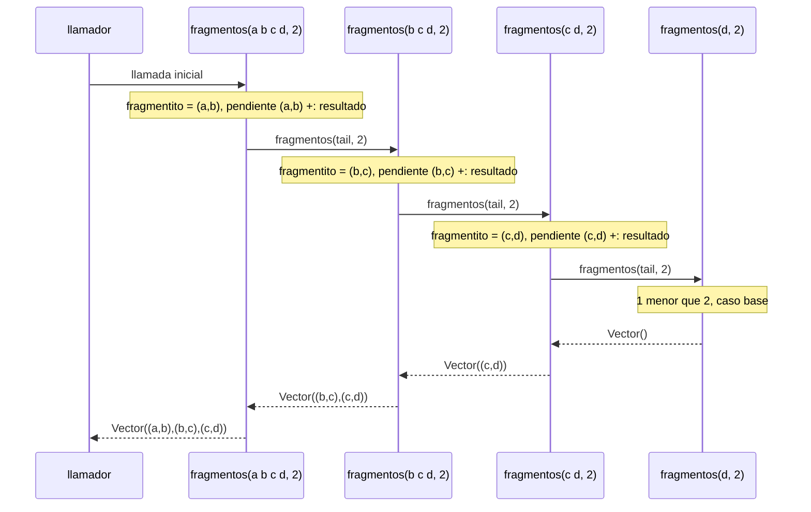

# Informe de procesos

Fundamentos de Programación Funcional y Concurrente — Universidad del Valle

## 1. Alcance del informe

De las doce funciones de la solución secuencial, `fragmentos` es la única que
se define con recursión propia. Las demás se resuelven con funciones de orden
superior sobre colecciones inmutables (`map`, `filter`, `foldLeft`, `flatMap`,
`sortWith`, `take`), y `parejas` con una expresión `for` con `yield`.

Este informe muestra:

1. La traza de `fragmentos`, con el estado de la pila de llamados en cada paso.
2. En qué operaciones se traduce el `for` de `parejas`.
3. El proceso que sigue cada función de orden superior, con el estado del
   acumulador en el caso de `indiceInvertido`.

## 2. `fragmentos`: recursión lineal

```scala
def fragmentos(ts: Vector[String], k: Int): Vector[Fragmento] = {
  if (ts.length < k || k < 1) {
    Vector()
  }
  else {
    val fragmentito = ts.take(k)
    fragmentito +: fragmentos(ts.tail, k)
  }
}
```

**Tipo de recursión.** Es recursión **lineal**: cada llamado genera a lo sumo
un llamado recursivo. **No es de cola**, porque después de que vuelve el
llamado recursivo todavía queda una operación pendiente: anteponer
`fragmentito` al resultado con `+:`. Por eso cada llamado queda en la pila
esperando a que termine el siguiente.

**Casos.**

- *Caso base:* `ts.length < k` (no hay una ventana completa de `k` palabras) o
  `k < 1` (valor no válido). Devuelve el vector vacío. La guarda `k < 1` además
  garantiza la terminación: con `k = 0` la condición `ts.length < k` nunca se
  cumpliría y la función seguiría llamándose hasta fallar al pedir `tail` de un
  vector vacío.
- *Caso recursivo:* se toma la ventana inicial `ts.take(k)` y se antepone a los
  fragmentos del resto, `ts.tail`, que tiene una palabra menos.

### 2.1 Ejemplo 1: `fragmentos(Vector("a","b","c","d"), 2)`

Aquí `t = 4` y `k = 2`, así que el resultado debe tener `t - k + 1 = 3`
fragmentos. Llamamos `F1, F2, F3, F4` a los marcos de pila en el orden en que
se crean; `□` marca el resultado del llamado recursivo que está pendiente.

| Paso | Qué ocurre | Pila (base → tope) |
|---|---|---|
| 1 | Llamada inicial `F1 = fragmentos(⟨a,b,c,d⟩, 2)`. Como `4 < 2` es falso y `2 < 1` es falso, entra al `else`: `fragmentito = ⟨a,b⟩`. | `F1` |
| 2 | `F1` llama a `fragmentos(⟨b,c,d⟩, 2)` y queda esperando con la operación `⟨a,b⟩ +: □`. | `F1[⟨a,b⟩ +: □]`, `F2` |
| 3 | `F2`: `3 < 2` falso. `fragmentito = ⟨b,c⟩`. Llama a `fragmentos(⟨c,d⟩, 2)`. | `F1[⟨a,b⟩ +: □]`, `F2[⟨b,c⟩ +: □]`, `F3` |
| 4 | `F3`: `2 < 2` falso. `fragmentito = ⟨c,d⟩`. Llama a `fragmentos(⟨d⟩, 2)`. | `F1[⟨a,b⟩ +: □]`, `F2[⟨b,c⟩ +: □]`, `F3[⟨c,d⟩ +: □]`, `F4` |
| 5 | `F4`: `1 < 2` verdadero. **Caso base**: devuelve `Vector()`. | `F1[…]`, `F2[…]`, `F3[…]`, `F4 → Vector()` |
| 6 | Sale `F4`. `F3` calcula `⟨c,d⟩ +: Vector() = Vector(⟨c,d⟩)` y devuelve. | `F1[⟨a,b⟩ +: □]`, `F2[⟨b,c⟩ +: □]`, `F3 → Vector(⟨c,d⟩)` |
| 7 | Sale `F3`. `F2` calcula `⟨b,c⟩ +: Vector(⟨c,d⟩) = Vector(⟨b,c⟩,⟨c,d⟩)`. | `F1[⟨a,b⟩ +: □]`, `F2 → Vector(⟨b,c⟩,⟨c,d⟩)` |
| 8 | Sale `F2`. `F1` calcula `⟨a,b⟩ +: Vector(⟨b,c⟩,⟨c,d⟩)` y devuelve el resultado final. | `F1 → Vector(⟨a,b⟩,⟨b,c⟩,⟨c,d⟩)` |
| 9 | Sale `F1`. La pila queda vacía. | — |



**Lectura del proceso.** Primero la pila **crece** (pasos 1 a 5) hasta llegar
al caso base, y luego se **deshace** (pasos 6 a 9), construyendo el resultado
de atrás hacia adelante: cada marco antepone su ventana al resultado que le
llega. La profundidad máxima es 4 marcos, que en general es `t - k + 2`
(los `t - k + 1` marcos que aportan un fragmento, más el marco del caso base).

### 2.2 Ejemplo 2: documento más corto que `k`

`fragmentos(Vector("x","y"), 3)`

| Paso | Qué ocurre | Pila |
|---|---|---|
| 1 | `2 < 3` es verdadero: caso base inmediato, devuelve `Vector()`. | `F1 → Vector()` |

Un solo marco, sin recursión. Es el comportamiento que pide el enunciado:
`t < k` no produce ningún fragmento.

### 2.3 Ejemplo 3: `k` no válido

`fragmentos(Vector("a","b","c"), 0)`

| Paso | Qué ocurre | Pila |
|---|---|---|
| 1 | `3 < 0` es falso, pero `0 < 1` es verdadero: caso base, devuelve `Vector()`. | `F1 → Vector()` |

Sin la guarda `k < 1` la función entraría al `else` una y otra vez con `k = 0`
(`ts.length < 0` nunca es verdadero) hasta llamar a `tail` sobre un vector vacío.

### 2.4 Análisis

- **Profundidad de la pila:** `t - k + 2` marcos como máximo. Con los tamaños
  del enunciado (`t ≤ 1000`) no hay riesgo de desbordamiento.
- **Costo:** cada marco hace un `take(k)` de costo proporcional a `k`, y
  `tail` sobre un `Vector` no copia el vector completo. El trabajo total es del
  orden de `(t - k + 1) · k`.
- **Por qué no se hizo de cola:** con acumulador sería posible, pero habría que
  construir el resultado al revés o invertirlo al final. Se dejó la versión
  lineal porque es la que sigue directamente la definición
  $g_i = \langle w_i, \ldots, w_{i+k-1} \rangle$ y porque su corrección se
  demuestra por inducción sobre la longitud del vector.

## 3. `parejas`: la expresión `for`

```scala
def parejas(n: Int): Vector[Pareja] = {
  (for {
    i <- 0 until n
    j <- (i + 1) until n
  } yield (i, j)).toVector
}
```

El compilador traduce un `for` con `yield` a llamados de orden superior. Como
aquí no hay condiciones (`if`) dentro del `for`, no aparece `filter`; solo
`flatMap` para el generador externo y `map` para el interno:

```scala
(0 until n).flatMap(i => ((i + 1) until n).map(j => (i, j))).toVector
```

**Ejemplo: `parejas(3)`**

| `i` | Rango de `j` = `(i+1) until 3` | Lo que produce el `map` interno |
|---|---|---|
| 0 | 1, 2 | `(0,1)`, `(0,2)` |
| 1 | 2 | `(1,2)` |
| 2 | vacío | nada |

El `flatMap` concatena los tres resultados en ese orden y `toVector` lo
convierte en `Vector((0,1), (0,2), (1,2))`. Son `3·2/2 = 3` parejas. Para
`n = 0` o `n = 1` los rangos están vacíos y el resultado es el vector vacío.

## 4. El enfoque de funciones de orden superior

Ninguna de las funciones restantes usa recursión escrita a mano, variables
mutables ni ciclos: cada una se obtiene combinando operaciones de las
colecciones. La tabla resume qué operación hace el trabajo en cada una.

| Función | Operaciones que usa | Qué hace cada una |
|---|---|---|
| `normalizar` | `toLowerCase`, `replaceAll`, `split`, `toVector`, `filter` | Pasa a minúsculas, reemplaza por espacio todo lo que no sea letra o dígito, parte en palabras y descarta las vacías. |
| `huella` | `toSet` sobre `fragmentos` | Convierte la secuencia de fragmentos en conjunto: un fragmento repetido cuenta una vez. |
| `huellas` | `map` | Aplica `huella` a cada documento y conserva el orden del corpus. |
| `jaccard` | `union`, `intersect`, `size` | Calcula los dos tamaños y los divide, con 0.0 si la unión es vacía. |
| `similitudes` | `map` con `case (i, j)` | Convierte cada pareja en una medición `(i, j, J)`, en el mismo orden. |
| `indiceInvertido` | `zipWithIndex`, `foldLeft` doble, `updated` | Recorre las huellas con su posición y acumula el mapa fragmento → documentos. |
| `parejasCandidatas` | `values`, `flatMap`, `sorted`, `map`, `distinct` | Genera las parejas de cada entrada del índice, quita repetidas y ordena. |
| `ranking` | `filter`, `sortWith`, `take` | Filtra por umbral, ordena por similitud descendente con desempate por posición y trunca a `p`. |
| `detectarDirecto` | composición | `huellas` → `parejas` → `similitudes` → `ranking`. |
| `detectarConIndice` | composición | `huellas` → `indiceInvertido` → `parejasCandidatas` → `similitudes` → `ranking`. |

### 4.1 Proceso de `indiceInvertido` sobre un ejemplo

`foldLeft` no deja marcos pendientes en la pila: lleva un **acumulador** (aquí,
el mapa) que se actualiza en cada paso. Para
`hs = Vector(Set(⟨a⟩), Set(⟨a⟩, ⟨b⟩))`:

| Paso | Huella (posición) | Fragmento visitado | Acumulador después |
|---|---|---|---|
| 0 | — | — | `Map()` |
| 1 | `{⟨a⟩}` (0) | `⟨a⟩` | `Map(⟨a⟩ → {0})` |
| 2 | `{⟨a⟩, ⟨b⟩}` (1) | `⟨a⟩` | `Map(⟨a⟩ → {0,1})` |
| 3 | `{⟨a⟩, ⟨b⟩}` (1) | `⟨b⟩` | `Map(⟨a⟩ → {0,1}, ⟨b⟩ → {1})` |

Dentro de una huella el orden en que se visitan los fragmentos no importa
(pasos 2 y 3 podrían intercambiarse): agregar una posición a un conjunto es una
operación conmutativa e idempotente, y el resultado final es el mismo.

### 4.2 Proceso de `parejasCandidatas` sobre un ejemplo

Para el índice `Map(⟨a⟩ → {5,1,3}, ⟨b⟩ → {3,1})`:

| Paso | Entrada | Conjunto ordenado | Parejas que genera |
|---|---|---|---|
| 1 | `⟨a⟩ → {5,1,3}` | `⟨1,3,5⟩` | `(1,3)`, `(1,5)`, `(3,5)` |
| 2 | `⟨b⟩ → {3,1}` | `⟨1,3⟩` | `(1,3)` |
| 3 | `flatMap` concatena | — | `(1,3)`, `(1,5)`, `(3,5)`, `(1,3)` |
| 4 | `distinct` | — | `(1,3)`, `(1,5)`, `(3,5)` |
| 5 | `sorted` | — | `(1,3)`, `(1,5)`, `(3,5)` |

Ordenar el conjunto antes de usar `parejas(m)` garantiza que cada pareja salga
con `i < j`; `distinct` elimina las que aparecen por más de un fragmento.
